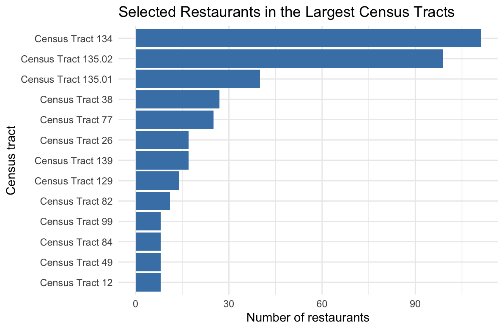

# yelp-new-orleans-project
# New Orleans Regional Restaurant Analysis

## Research question

Which geographic area is most useful for comparing Cajun/Creole, seafood, and Southern restaurants in New Orleans?

## Selected restaurant categories

I selected Cajun/Creole, seafood, and Southern restaurants because they are related to regional Louisiana and Southern cuisine.

Before selecting the final restaurant group, the Yelp data contained:

| Category | Number of restaurants |
|---|---:|
| Cajun/Creole | 401 |
| Seafood | 331 |
| Southern | 155 |

I included a business if its Yelp categories contained at least one of these three categories. Because a business can belong to multiple Yelp categories, the category counts can overlap. After removing duplicate businesses, the selected group contained 648 unique restaurants. These restaurants appeared across 25 ZIP-code values, providing enough geographic locations for comparison.

## Geographic comparison

I compared Census tracts and ZIP Code Tabulation Areas (ZCTAs).

| Geographic system | Number of areas | Restaurants assigned | Unmatched restaurants | Smallest area count | Largest area count |
|---|---:|---:|---:|---:|---:|
| Census tract | 108 | 632 | 16 | 1 | 111 |
| ZIP/ZCTA | 24 | 648 | 0 | 1 | 212 |

## Official New Orleans boundary

I used restaurant latitude and longitude values to create map points. I then used an official Louisiana boundary from the Census TIGER/Line data and completed a spatial join.

The spatial join showed that 632 restaurants were inside the official New Orleans boundary. 16 restaurants were labeled “New Orleans” by Yelp but were located outside the official boundary in nearby places.

## Census tract comparison

Census tracts provided more detailed geographic divisions, but they produced 108 areas and 16 unmatched restaurants. Some tracts contained only one restaurant, which makes comparisons based on those areas less stable.

## ZIP/ZCTA comparison

ZIP/ZCTAs produced 24 geographic areas and assigned all 648 selected restaurants. Because all restaurants were assigned to a ZCTA, this system made the geographic comparison easier to interpret. However, the areas contained unequal numbers of restaurants, so areas with a small number of restaurants should be interpreted cautiously.

## Geographic system selected

I selected ZIP/ZCTAs as the main geographic system because they were easier to understand, assigned all 648 restaurants, and produced fewer and more manageable areas than Census tracts. Census tracts were useful as a detailed comparison, but their larger number of areas and 16 unmatched restaurants made them less practical for the main analysis. ZIP/ZCTAs are postal geographic areas and should not automatically be interpreted as neighborhoods.

## Code

The analysis code is available in [project_analysis.R](project_analysis.R).
