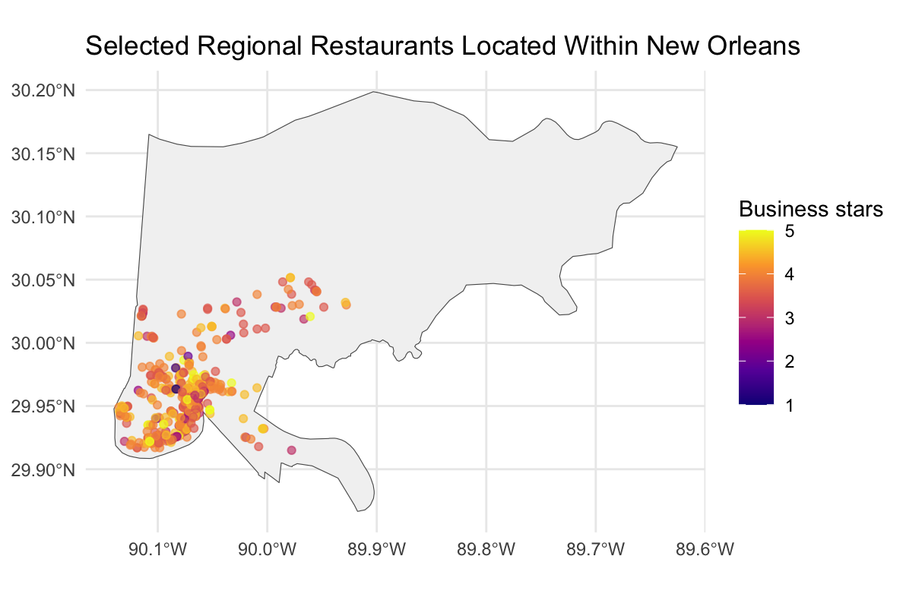
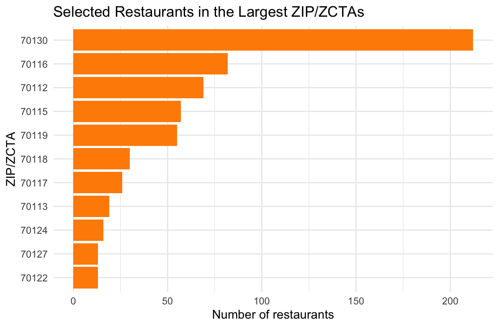
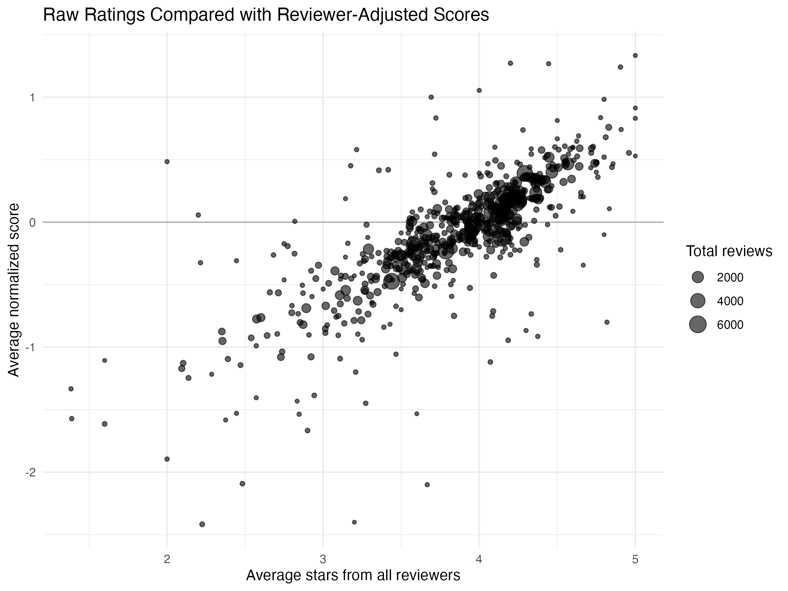
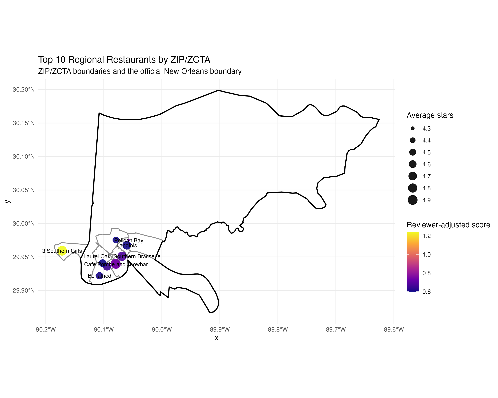

# yelp-new-orleans-project
# New Orleans Regional Restaurant Analysis

## Research question

Which geographic area is most useful for comparing regional Louisiana food, specifically Cajun/Creole, seafood, and Southern restaurants in New Orleans?

## Executive summary

This project analyzes Yelp reviews of restaurants in New Orleans within the Cajun/Creole, seafood, and Southern categories. I compared both Census tracts and ZIP Code Tabulation Areas (ZCTAs) to determine which geographic system best supports these restaurant comparisons. ZIP/ZCTAs were selected because they assigned all of the 648 restaurants in the chosen categories and were easier to interpret. I also adjusted restaurant ratings based on reviewer scoring behavior and identified the top 10 restaurants using these reviewer-normalized scores.

## Selected restaurant categories

When I travel I personally love trying the local cuisine, that is why I selected Cajun/Creole, seafood, and Southern restaurants.

Before selecting the final restaurant group, the Yelp data contained:

| Category | Number of restaurants |
|---|---:|
| Cajun/Creole | 401 |
| Seafood | 331 |
| Southern | 155 |

I included a restaurant if its Yelp categories contained at least one of the three categories. Because a business can belong to multiple Yelp categories, the category counts can, and do, overlap. After removing any duplicate businesses, the final group contained 648 unique restaurants. These restaurants appeared across 25 ZIP-code values, providing enough geographic locations for a fair comparison.

### Category co-occurrence

As mentioned earlier, some restaurants belonged to more than one selected category:

| Category pair | Restaurants in both categories |
|---|---:|
| Cajun/Creole and Seafood | 156 |
| Cajun/Creole and Southern | 72 |
| Seafood and Southern | 45 |

These overlaps show that the selected categories are related and that my target of finding local cuisine is likely represented well by these categories. Removing the duplicates of these restaurants that belonged in multiple categories was crucial to ensure that the analyses were not inaccurate by counting the same restaurant more than once.

## Large-data management

The Yelp Open Dataset was downloaded as large JSON files containing one record per line. The business and review files were stored locally in `data/raw/`, which is excluded from GitHub using `.gitignore`.

Because the raw files were large and even caused my laptop to slow down and heat up during import, I kept only the columns needed for the project. This ensured that as I completed the project, I would only be opening and running the data that was relevant to my findings. I imported the review file in chunks, filtered reviews to New Orleans restaurants during the import process, and saved the filtered business and review data as compressed `.RDS` files. I then used the smaller `.RDS` files for the rest of the analysis instead of repeatedly reopening the raw JSON files.

## Official New Orleans boundary

I used restaurant latitude and longitude values to create map points. I then used an official Louisiana boundary from the Census TIGER/Line data and completed a spatial join.

The spatial join showed that 632 restaurants were inside the official New Orleans boundary. 16 restaurants were labeled “New Orleans” by Yelp but were located outside the official boundary in nearby places.

## Census tract comparison

Census tracts provided detailed geographic divisions, but they produced 108 areas and 16 unmatched restaurants. Some tracts contained only one restaurant, which makes comparisons based on those areas less stable.

## ZIP/ZCTA comparison

ZIP/ZCTAs produced 24 geographic areas and assigned all 648 selected restaurants. Because all restaurants were assigned to a ZCTA, this system made the geographic comparison easier to interpret. However, the areas contained unequal numbers of restaurants, so areas with a small number of restaurants should be interpreted carefully.

## Geographic comparison

I compared Census tracts and ZIP Code Tabulation Areas (ZCTAs).

| Geographic system | Number of areas | Restaurants assigned | Unmatched restaurants | Smallest area count | Largest area count |
|---|---:|---:|---:|---:|---:|
| Census tract | 108 | 632 | 16 | 1 | 111 |
| ZIP/ZCTA | 24 | 648 | 0 | 1 | 212 |

## Geographic system selected

I selected ZIP/ZCTAs as the main geographic system because they were easier to understand, assigned all 648 restaurants, and produced fewer and more manageable areas than Census tracts. Census tracts were useful as a detailed comparison, but their larger number of areas and 16 unmatched restaurants made them less practical for the main analysis. ZIP/ZCTAs are postal geographic areas and should not automatically be interpreted as neighborhoods.

## Code

The analysis code is available in [project_analysis.R](project_analysis.R).

## Reviewer-adjusted ratings

I first calculated ordinary Yelp ratings using all reviews for the 648 selected restaurants. I then identified reviewers who had written at least five reviews within my selected restaurant categories. This threshold was used because reviewers with only one or two reviews do not provide substantial evidence about their usual rating behavior.

For each reviewer, I calculated their average rating across the selected categories. I then subtracted that personal average from each individual review. A positive normalized score indicates that the reviewer rated a restaurant higher than their usual rating behavior, while a negative score means that they rated it lower than their usual. 

There were 138,073 total reviewers and of those, 7,052 were considered eligible reviewers that had written at least five reviews. Nine restaurants did not have enough eligible-reviewer information to appear in the raw-versus-adjusted comparison plot.

## Top 10 restaurants

The final ranking used the average reviewer-normalized score and required each restaurant to have at least five reviews from eligible reviewers.

| Restaurant | Average stars from all reviewers | Eligible reviews | Reviewer-normalized score |
|---|---:|---:|---:|
| 3 Southern Girls | 4.90 | 7 | 1.240 |
| Cafe Porche and snowbar | 4.83 | 11 | 0.759 |
| La Vie En Rose Cafe | 4.91 | 7 | 0.741 |
| Pelican Bay | 4.28 | 7 | 0.738 |
| Laurel Oak, Southern Brasserie | 4.81 | 6 | 0.679 |
| MKM Creations | 4.62 | 7 | 0.648 |
| Bonafried | 4.55 | 18 | 0.608 |
| Langlois | 4.73 | 9 | 0.604 |
| Orchid Seafood | 4.48 | 16 | 0.601 |
| Crump's Seafood Market & Sandwich Shop | 4.60 | 5 | 0.599 |

The reviewer-adjusted ranking differs from a simple ranking by average Yelp stars. This suggests that reviewer scoring habits affect which restaurants appear strongest. Restaurants with very few reviews should still be interpreted cautiously because their averages are less stable.

## Limitations

This analysis uses Yelp businesses and reviews, so the results represent Yelp users rather than all of the restaurants’ customers. ZIP/ZCTAs are postal geographic areas and should not automatically be interpreted as neighborhoods. Some areas contain very few restaurants compared to others, making their averages less stable. Reviewer-normalized scores measure ratings relative to each reviewer's usual behavior; they are not replacement Yelp ratings.

## Project files

- [Import and filtering code](R/import_filter.R)
- [Analysis code](project_analysis.R)
- [Figures](figures/)
- [Results tables](results/)
- [README report](README.md)

The raw Yelp JSON files are not included in the repository because they are very large and are excluded through `.gitignore`.

## Important AI prompts used

The JSON files are very large and take a long time for my laptop to run, how can I make sure that when I am completing this project I am only running/using the data I need?

For this project I want to focus on regional Louisiana food and pick my 3 categories as cajun/creole, seafood and southern. Can you make any modifications necessary to the spatial-join code?

There was an error in st_geos_binop and st_crs for x and y are not equal. How are the coordinates referencing two different maps? How can I ensure they reference the same map and that coordinates are properly plotted on them?

This block of code gave me a warning about mutate() and said all formats failed to parse. What specifically caused this error and how can we avoid future warnings? Warning message:
 There was 1 warning in `mutate()`.
 ℹ In argument: `review_date = ymd(date)`.
 Caused by warning:
 ! All formats failed to parse. No formats found. 

The reviewer-adjusted restaurant table is meant to be a representation of a reviewer’s rating behavior compared to the reviews made for the restaurants in the chosen categories. How can I save these important results?